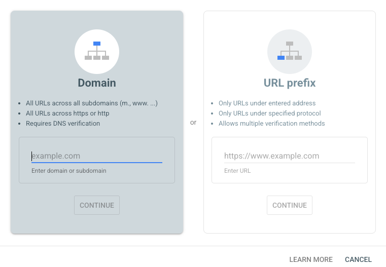
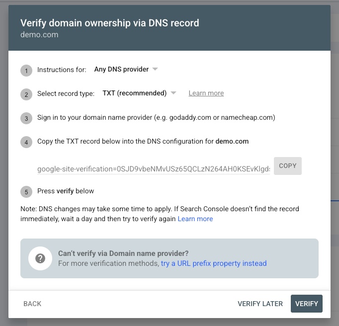
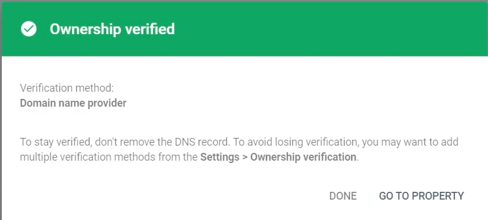
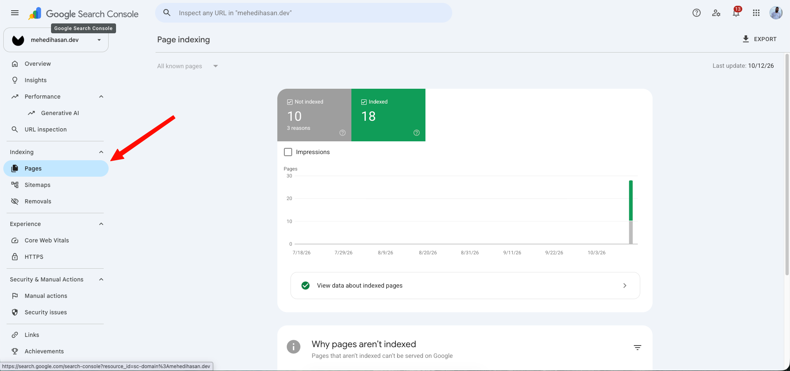
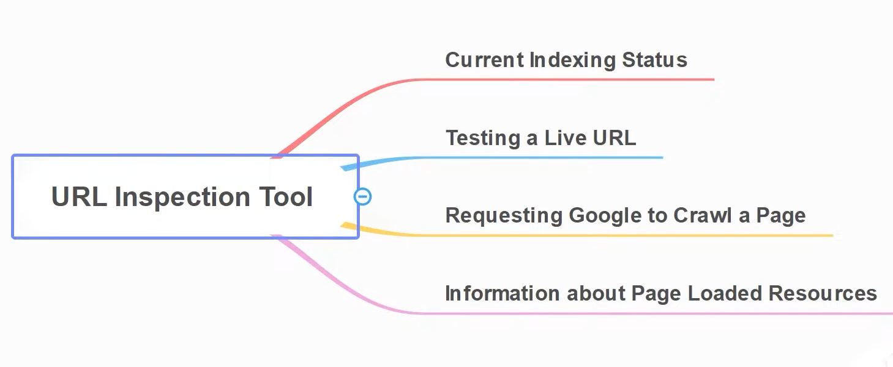
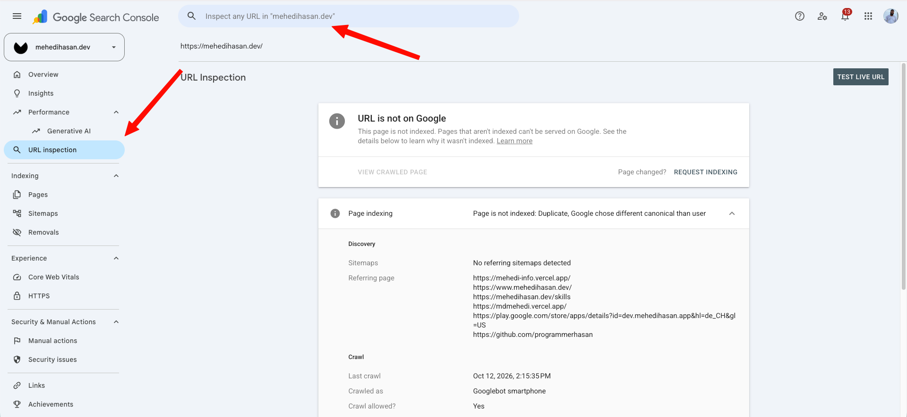

--- first note
This video (0:00 - 10:41) explains the fundamentals of **Google Search Console (GSC)** and its importance for SEO professionals. Below are the key takeaways:

### **What is Google Search Console? (0:00 - 4:28)**
*   **Definition:** It is a free tool provided by Google that acts as a **bridge** between your website and the Google search engine.
*   **Core Purpose:** It helps you understand how Google's bots (crawlers) interact with your website, allowing you to monitor site health and accessibility.

### **Why do you need GSC? (4:30 - 7:30)**
*   **Indexing & Crawling:** It confirms which of your pages have been successfully crawled and indexed by Google.
*   **Troubleshooting:** It notifies you of technical errors, crawl issues, or security concerns (like malware) that might prevent your site from performing well.
*   **Performance Tracking:** You can view how your pages perform in **Google Search Engine Results Pages (SERPs)**, including metrics like impressions and clicks (7:31 - 8:45).
    *   *Note:* GSC focuses on search performance, not visitor behavior or demographics, which are tracked in tools like *Google Analytics*.

### **Additional Insights**
*   **Other Search Engines:** Similar to Google, *Bing* offers its own *Webmaster Tools*, which are essential if you want your site to rank effectively on their platform (9:45 - 10:12).
*   **Advanced Needs:** While GSC is excellent for monitoring, you may eventually need paid tools for detailed backlink analysis or advanced SEO reporting as your website scales (8:45 - 9:25).

--- second note
This video explains the two ways to add a website property to *Google Search Console*: **Domain Property** and **URL Prefix Property**. Understanding the differences helps in selecting the right setup for your site's data analysis needs.

### **1. Domain Property**
*   **Definition:** This covers the entire domain, including all subdomains (e.g., *m.example.com*, *academy.example.com*) and multiple protocols (*http* and *https*).
*   **Setup:** You simply enter the root domain (e.g., *example.com*) without any prefixes (1:48).
*   **Verification:** Requires **DNS verification** via your hosting provider (4:49).
*   **Best for:** When you want a comprehensive, unified report for your entire website ecosystem (10:55).

### **2. URL Prefix Property**
*   **Definition:** This tracks specific URLs or sub-directories (e.g., *example.com/blog*). It only monitors the exact URL path you submit (5:03).
*   **Limitation:** It does not automatically track subdomains or alternative protocols (like *https* vs *http*) unless they are added as separate properties (12:05).
*   **Best for:** When you want to isolate data for specific sections of your website, such as a dedicated blog or sub-directory, for deeper study (8:46).

### **Key Takeaways**
*   **Data Consistency:** Both methods provide the same data; the difference lies in how that data is grouped and represented in your dashboard (9:56).
*   **Flexibility:** You can use both methods simultaneously (6:08). For instance, you might add the domain property for global tracking while creating separate URL prefix properties for high-traffic sections like a blog to analyze them individually (8:46).
*   **Capacity:** *Google Search Console* allows you to add up to 1,000 properties per account (1:50).

---

## Steps for DNS Verification

success domain verification

**Steps for DNS Verification:**
1. **Access Google Search Console:** Navigate to the property setup section and select the **Domain** property type (0:37).
2. **Copy TXT Record:** Copy the unique TXT record provided by *Google Search Console* (1:21).
3. **Configure DNS:** Log in to your hosting provider's account (e.g., *Hostinger*), locate your domain, and open the **DNS Editor** (1:30 - 1:49).
4. **Add Record:** 
   * Set the type to **TXT**.
   * Enter your domain name in the name/host field.
   * Paste the value provided by *Google* into the TXT value field.
   * Leave the TTL at its default setting and save the record (2:48 - 3:17).
5. **Verify:** Return to *Google Search Console* and click the **Verify** button (3:24).

**Key Differences & Insights:**
* **Verification Time:** While it can happen instantly (3:26), it may sometimes take up to 24 hours to propagate, though it usually resolves within 15–30 minutes (1:53 - 2:14).
* **Domain vs. URL Prefix:** Using the **Domain verification method** is advantageous because it automatically tracks and provides insights for all **subdomains** associated with your site, which is not possible with the standard URL-prefix method (4:08 - 4:27).

---

This video explains the importance of **Indexing Pages reports** in *Google Search Console* for website owners and SEO beginners. Here are the key takeaways:

**Why Pages Reports Matter:**
* **Foundation of SEO:** Before focusing on performance or rankings, you must ensure Google has discovered and indexed your pages. If a page isn't in the index, it cannot appear in search results (0:01:54-0:02:27).
* **Troubleshooting:** This report acts as a notification system, alerting you to crawling and indexing issues along with suggestions on how to resolve them (0:01:28-0:01:52).

**Key Metrics in the Pages Report (0:06:37-0:09:00):**
* **Error:** Pages that cannot be indexed. These should always be addressed to reach zero errors.
* **Valid with warnings:** Pages that are indexed but have specific issues that need attention.
* **Valid:** Pages that are successfully indexed. 
* **Excluded:** Pages that Google has intentionally left out of the index. 

**Understanding 'Excluded' Pages (0:09:04-0:12:00):**
* **Alternate page with proper canonical tag:** Google found duplicate content and prioritized the 'master' version (0:09:24-0:10:00).
* **Not found (404):** Pages that no longer exist (0:11:34-0:11:40).
* **Duplicate without user-selected canonical:** Similar content exists on multiple URLs without a designated primary source, causing confusion for search engines (0:11:41-0:11:57).

**Important Workflow Tips:**
* **Page-by-page:** SEO is handled page-by-page. Always investigate specific URLs when errors arise (0:06:50-0:07:05).
* **Sitemaps:** While sitemaps are useful for helping Google discover content, they are not the sole source of indexing; Google also discovers pages through crawling (0:04:05-0:05:40).
* **Patience:** After making fixes, it takes time for *Google Search Console* to update and reflect the changes in the report (0:12:03-0:12:28).

---
## URL Inspection Tool in Google Search Console

1.  **Check Indexing Status (1:29 - 1:41):** Verify if a specific URL is currently indexed on *Google*.
2.  **Test Live URL (1:42 - 1:52):** Test how the live version of a webpage appears and functions.
3.  **Request Indexing (2:01 - 2:16):** Request that *Google* re-index a page after updates or changes are made.
4.  **Inspect Page Details (2:17 - 2:44):** View information about page load resources, including JavaScript/CSS issues, Schema markup, and mobile-friendliness.

**How to use the tool:**
*   You can enter a URL directly into the **URL Inspection** search bar at the top of the dashboard (2:51 - 3:00).
*   Alternatively, you can access the tool by clicking the search icon next to any URL found within other reports, such as the **Coverage Report** (3:11 - 3:23).

**Key Report Sections (3:39 - 4:48):**
*   **Discovery:** Shows how the URL was found (e.g., via sitemaps).
*   **Crawl:** Details the last crawl date, the user agent used (*Googlebot*), and crawl status.
*   **Indexing:** Confirms if the page is indexed, the user-declared canonical URL, and the *Google*-selected canonical URL.
*   **Enhancements:** Displays reports for structured data (Schema) and mobile usability.

If a page has errors or is not indexed properly, the tool provides specific insights into why (e.g., the URL is not submitted in the sitemap) so you can fix these issues to improve your site's SEO (5:01 - 5:45).

---
how to navigate and utilize the **Performance Report** in *Google Search Console* to analyze your website's search engine traffic. Here are the key takeaways:

### **Understanding the Performance Report**
* **Purpose:** The report tracks how your web pages perform on *Google Search* (0:25). It shows which queries bring users to your site and how your pages rank.
* **Core Metrics:**
    * **Clicks:** Total number of users who clicked through to your site (1:37).
    * **Impressions:** How often your site appeared in search results for a specific query (1:37).
    * **CTR (Click-Through Rate):** The percentage of users who saw your link and clicked it (1:38).
    * **Average Position:** The average ranking of your pages across various queries (1:40). *Note: The host emphasizes that 'Average Position' can be misleading and recommends focusing on specific query-level data instead (9:45, 11:45).* 

### **How to Use Filters for Analysis**
* **Search Type:** You can filter data by *Web*, *Images*, *Videos*, or *News* to see where your traffic originates (2:51).
* **Date Range:** Adjusting the time frame (e.g., 7 days vs. 3 months) is crucial for identifying trends (5:45). The **Compare** feature is particularly useful for measuring performance improvements over time (6:42).
* **Granular Data:** You can view data broken down by:
    * **Queries:** See which specific keywords drive traffic (16:25).
    * **Pages:** Analyze which individual pages attract the most clicks (13:46).
    * **Countries/Devices:** Understand your audience's geography and how they access your content (15:48, 16:08).

### **Strategic Takeaways**
* **Don't just observe data:** The host stresses that a report is only useful if it leads to **actionable decisions** (1:53). Use the data to identify high-potential queries, then create new content or blog posts around those topics to capture more traffic (20:14).
* **Secondary Keywords:** Look for related queries in the report that your site is already ranking for, as these represent opportunities for further optimization (18:33).

---
explains how to use the **Removals Tool** in *Google Search Console* to temporarily hide specific URLs from Google Search results. Here are the key takeaways:

### **Key Concepts**
* **Purpose of the Tool:** It is designed for **temporary removal** (0:27-1:30). Many users mistakenly believe this permanently deletes a page from the internet or the website's index; however, it only hides the URL from *Google Search* results for six months (3:08).
* **How to Submit a Request:** 
    1. Go to *Google Search Console*.
    2. Navigate to the **Removals** section under the **Index** category (0:47).
    3. Click **New Request** to submit the specific URL you wish to hide (0:53).

### **Available Options**
When submitting a request, you can choose between two main options (2:40):
* **Remove this URL only:** Hides only the specific page entered (2:41).
* **Remove all URLs with this prefix:** Hides the specific URL and any other pages that follow that path on your site (2:48-2:56).

### **Important Considerations**
* **Clearing Cache:** The tool clears the current snippet and cached version of the page from Google's database (3:11-3:45).
* **Permanent Solutions:** For permanent removal, you should either delete the page from your website or set it to **404 (Not Found)** status, or use the **noindex** tag (2:07-2:25, 4:01-4:12).
* **Other Features:** The *Removals* section also allows you to track **Outdated Content** requests (reported by users) and **SafeSearch filtering** requests (for adult content) (4:20-5:12).

---

the **Manual Actions** and **Security Issues** reports within *Google Search Console*. These reports are critical for website owners to monitor because they indicate penalties or security vulnerabilities that can impact search rankings and user safety.

### **Manual Actions** (0:57 - 4:53)
*   **Definition:** These are penalties applied to a site by *Google* human reviewers when they determine a site violates *Google’s* webmaster guidelines. 
*   **How it works:** Unlike automated algorithmic changes, these are manual checks. If a site is penalized, you will receive a notification in *Google Search Console* detailing the specific issue.
*   **Consequences:** Penalized URLs or the entire site may disappear from search results, leading to a loss in traffic and visibility.
*   **Common Triggers:** 
    *   Third-party spam or user-generated spam (e.g., comment spam) (3:51).
    *   Unnatural outbound or inbound links (4:07).
    *   Content that attempts to deceive search engine crawlers (4:34).

### **Security Issues** (4:54 - 7:53)
*   **Definition:** These alerts indicate that a website has been compromised or poses a threat to users, often resulting in browser warning prompts (6:05).
*   **Key Security Threats:**
    *   **Malware Content:** Malicious code or scripts injected into your site (6:35).
    *   **Deceptive Pages:** Pages designed to mimic trusted sites (phishing) to steal user data (6:46).
    *   **Deceptive Embedded Resources:** Embedding code or files that misguide users or encourage the download of unwanted software (7:00).
*   **Prevention:** To avoid these issues, focus on maintaining clean code, managing user-generated content, and strictly adhering to *Google's* webmaster policies.

---
This video (0:00 - 7:39) provides an overview of the **Links Report** (or Backlink Report) within *Google Search Console*. Here are the key takeaways:

**Overview of the Links Section:**
* The report is located in the *Google Search Console* dashboard under the **Links** section (0:40).
* While available, many professional SEOs do not rely solely on this report because it lacks the deep, granular insights provided by premium tools like *Ahrefs* or *Semrush* (1:00-1:43).

**Key Metrics Explained:**
* **Top Linked Pages:** Shows which pages on your site receive the most external links. Typically, the homepage has the highest number of backlinks (2:16-2:42).
* **External Links:** Defines which external websites point to your content. Note that *Google* combines data; if one domain has multiple links to one of your pages, it is often counted differently than multiple unique domains (3:00-4:30).
* **Internal Links:** Highlights how your website pages are interlinked, helping you assess your internal linking strategy (5:16-5:43).
* **Top Linking Sites:** Displays the domains that provide the most backlinks to your site (5:45-6:13).
* **Top Linking Text (Anchor Text):** Shows the text used in external links pointing to your site. This is important to check for relevance to your website’s content (6:14-6:45).

**Final Conclusion:**
* *Umar Tazkeer* explains that while this report is useful for a quick overview, it does not offer competitor analysis or advanced link velocity/broken link data, which is why experts often prefer paid third-party alternatives (6:50-7:13).

---

This video explains the **Crawl Stats report** in *Google Search Console*, which is essential for understanding how *Google's* crawler interacts with your website. Here are the key takeaways:

**What is the Crawl Stats Report?** (0:56 - 1:52)
* Located under **Settings > Crawling** in *Google Search Console*.
* It provides a detailed history of crawling activity on your domain over the last 90 days.
* It helps you see how *Googlebot* views your website, providing data on the number of crawl requests and their success or failure rates.

**Key Metrics Explained** (3:30 - 4:12)
* **Total Requests:** The number of times *Google* has attempted to crawl your site.
* **Total Download Size:** The data size of the resources *Google* downloaded while crawling.
* **Average Response Time:** How long your server takes to respond to crawl requests.

**Analyzing Status and Issues** (4:13 - 6:29)
* **Host Status:** Monitors connectivity and server errors. A high rate of failed requests is a negative signal, potentially leading *Google* to reduce crawl frequency.
* **By Response:** Shows the HTTP status codes. You want to maximize **200 (OK)** responses and minimize errors like **404 (Not Found)** or other irrelevant requests, as these waste your crawl budget.

**Crawl Purpose and Optimization** (7:34 - 8:52)
* **Refresh:** Crawling pages that are already indexed to check for updates.
* **Discovery:** Crawling pages for the first time.
* **Crawl Budget:** For large websites, monitoring these stats is crucial to ensure *Google* spends its time on important pages rather than wasting resources on non-essential ones.
* **Conclusion:** While highly important for large websites, smaller sites can generally keep an eye on these to ensure everything is functioning correctly.