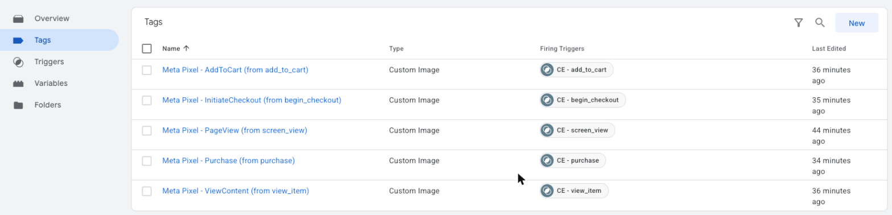
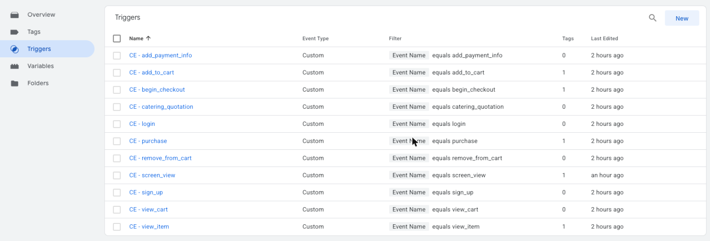
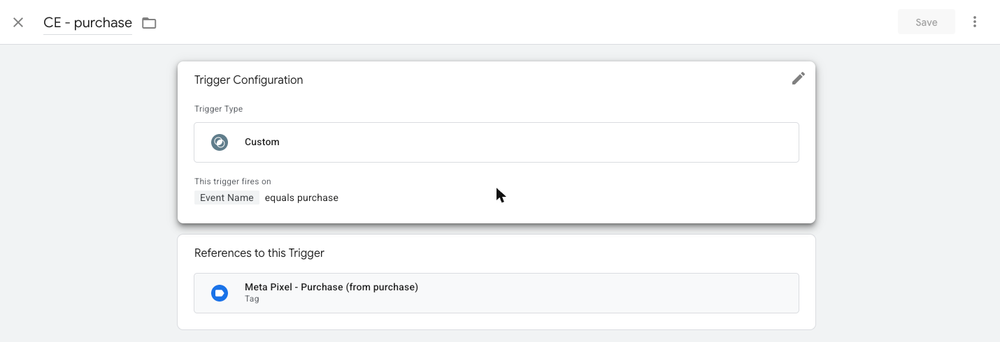
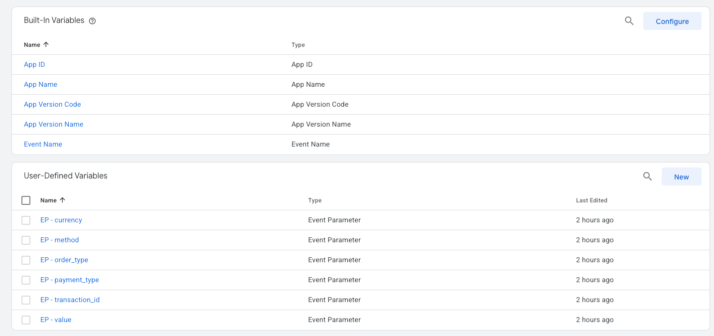
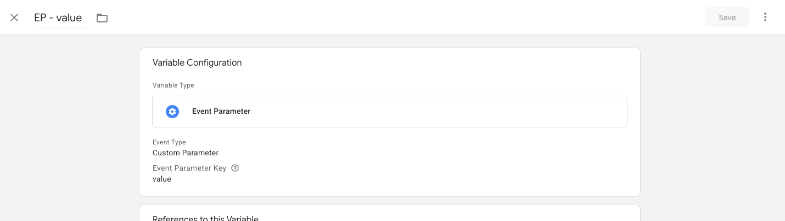
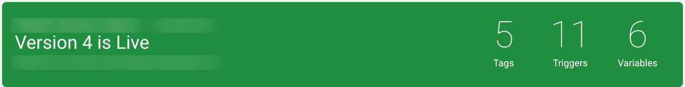
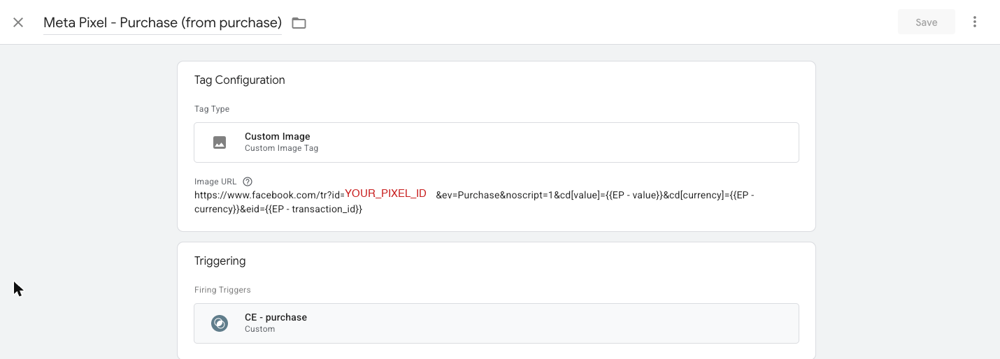

Every marketing tool wants its own snippet in your app: Google Analytics, Google Ads, the Meta Pixel, and more. Google Tag Manager (GTM) lets you add the tracking code once and then manage all of those tools from one dashboard, without a new app release for every change. This tutorial explains the three words you must understand first (tags, triggers, and variables) and then walks through a real setup that sends ecommerce events from GTM to Meta.

## What is Google Tag Manager?

Google Tag Manager is a free tool that decides **when** to send **which data** to **which marketing or analytics service**. Your developers install one GTM container in the website or app and send events like "added to cart". Marketers then use the GTM website to connect those events to tools such as GA4, Google Ads, or the Meta Pixel.

The main benefit is speed and control:

- A new tracking tag can go live in about 5 minutes after you click **Publish**, with no code deploy.
- Every change is saved as a numbered version, so you can roll back to any older version.
- **Preview mode** lets you test changes before real users see them.

## GTM vocabulary: the 8 words you need

Before clicking anything in GTM, learn these terms. Most GTM confusion comes from mixing up tags, triggers, and variables.

| Term | Meaning in one line | Example |
|---|---|---|
| **Account** | Your company in GTM. It holds one or more containers. | `My Company` |
| **Container** | One GTM setup for one website or one app platform. Has an ID like `GTM-XXXXXXX`. | Website container, Android container, iOS container |
| **Tag** | The **action**: code or a request that sends data to a tool. | "Send Purchase to Meta" |
| **Trigger** | The **when**: a rule that decides if a tag fires. | "When the event name equals `purchase`" |
| **Variable** | The **what**: a named value GTM reads at the moment of the event. | "The order total", "The currency" |
| **Event** | Something that happened in the app, sent by your code. | `add_to_cart`, `purchase` |
| **Workspace** | Your draft area. Changes here are not live yet. | "Default Workspace" |
| **Version / Publish** | A saved snapshot of the workspace. Publishing makes it live for all users. | "Version 4 is Live" |

A short way to remember the core three:

> **Trigger = WHEN. Variable = WHAT. Tag = DO.**

### What is a tag in Google Tag Manager?

A tag is the piece that **does something**: it sends data to another service. A GA4 tag sends an event to Google Analytics, a Google Ads tag records a conversion, and a Meta Pixel tag tells Meta that someone viewed a product or bought something.

A tag never fires on its own. It always needs at least one trigger.



In this container each tag sends one Meta event, and the **Firing Triggers** column shows which trigger controls it.

### What is a trigger in Google Tag Manager?

A trigger is a **condition**. GTM checks every incoming event against your triggers. When a trigger's condition is true, every tag attached to that trigger fires.

The most common trigger for apps is a **Custom** trigger with the rule `Event Name equals <name>`. If your app sends an event called `purchase`, a trigger with `Event Name equals purchase` matches it.



A naming pattern makes a large container easier to read. Here every trigger starts with `CE -` (Custom Event) followed by the exact event name. The **Tags** column shows how many tags use each trigger, so `0` means the trigger exists but nothing fires on it yet.



Opening a trigger shows its rule and, under **References to this Trigger**, the tags it fires.

### What is a variable in Google Tag Manager?

A variable is a **named piece of data** that GTM reads when an event happens. Tags use variables to fill in details, like the price and currency of a purchase. Triggers can also use variables in their rules. `Event Name` in the trigger above is a variable.

GTM has two kinds:

- **Built-in variables** come with GTM. Turn them on from **Variables → Configure**. Examples: `Event Name`, `App ID`, `Page URL`.
- **User-defined variables** are ones you create, such as reading the `value` parameter from a `purchase` event.



In a mobile app container, the type you use most is **Event Parameter**: it reads one parameter from the event the app sent. The prefix `EP -` keeps these easy to find in long lists.



`EP - value` reads the `value` key. If the app sends `purchase` with `value: 850`, then `{{EP - value}}` becomes `850` for that event.

### How tags, triggers, and variables work together

Here is one real event moving through GTM. A customer pays 850 BDT, and the app sends:

```text
purchase { value: 850, currency: "BDT", transaction_id: "INV123" }
```

| Step | GTM part | What happens |
|---|---|---|
| 1 | Trigger `CE - purchase` | Checks: does `Event Name` equal `purchase`? Yes, so it fires. |
| 2 | Variable `EP - value` | Reads `850` |
| 3 | Variable `EP - currency` | Reads `BDT` |
| 4 | Variable `EP - transaction_id` | Reads `INV123` |
| 5 | Tag `Meta Pixel - Purchase` | Sends a Purchase event to Meta, worth 850 BDT, with order id `INV123` |

The app sent **one** event. GTM decided where it should go and what data to attach. To also send the same purchase to Google Ads later, you add one more tag on the same trigger. The app code doesn't change.

## Web containers vs mobile app containers

GTM works differently on websites and in apps, and this changes which tags you can use.

| | Web container | Android / iOS container |
|---|---|---|
| How the app talks to GTM | `dataLayer.push({ event: 'purchase', ... })` | Firebase Analytics events (`logEvent`) |
| Custom HTML / JavaScript tags | ✅ Yes | ❌ No |
| Install | A `<script>` snippet in the page `<head>` | GTM SDK, Firebase Analytics, and a container JSON file bundled in the app |
| Updates | Live on next page load | The app downloads the new version, about every 12 hours |

Two points catch most people:

1. **Mobile GTM needs Firebase Analytics.** The mobile GTM SDK has no data layer of its own. It only listens to Firebase Analytics events. Your app logs an event to Firebase, and GTM reacts to it. A side effect is that every event also reaches GA4 automatically.
2. **Mobile containers cannot run JavaScript.** Any guide that says "paste this script into a Custom HTML tag" only works in a **Web** container.

## Set up Google Tag Manager in 6 steps

1. **Create a container.** Go to [tagmanager.google.com](https://tagmanager.google.com/), create an account, then create one container per platform: Web, Android, or iOS.
2. **Install it.**
   - Web: paste the GTM snippet into the site's `<head>` and `<body>`.
   - Mobile: add Firebase Analytics and the GTM SDK, then bundle the container JSON. On Android it goes in `app/src/main/assets/containers/`. On iOS it goes in a `container` folder added to Xcode as a folder reference.
3. **Send events from your code.** Use the same event names everywhere, for example `view_item`, `add_to_cart`, `begin_checkout`, and `purchase`. Sending the GA4 recommended names makes GA4 reports work without extra setup.
4. **Create variables** for each event parameter you need, such as `value`, `currency`, and `transaction_id`.
5. **Create triggers** with `Event Name equals <event>`, one per event.
6. **Create tags**, attach a trigger to each, test in Preview, then click **Submit → Publish**.



After publishing, the Versions page shows the live version and how many tags, triggers, and variables it contains.

## How to send events from Google Tag Manager to Meta

The Meta Pixel is Meta's tracking code. It tells Meta Ads what people do after they see an ad, so Meta can measure and optimise campaigns. The standard events used for ecommerce are:

| Meta standard event | When it should fire | Typical app event |
|---|---|---|
| `PageView` | A page or screen opens | `screen_view` / page load |
| `ViewContent` | Someone views a product or restaurant | `view_item` |
| `AddToCart` | An item is added to the cart | `add_to_cart` |
| `InitiateCheckout` | Checkout starts | `begin_checkout` |
| `Purchase` | An order is confirmed | `purchase` |

How you send them depends on the container type.

### Meta Pixel on a website: Custom HTML tags

On the web, use the official Meta Pixel script.

**Tag 1: base pixel.** Create a **Custom HTML** tag with Meta's base code and trigger it on **Initialization - All Pages**:

```html
<script>
!function(f,b,e,v,n,t,s)
{if(f.fbq)return;n=f.fbq=function(){n.callMethod?
n.callMethod.apply(n,arguments):n.queue.push(arguments)};
if(!f._fbq)f._fbq=n;n.push=n;n.loaded=!0;n.version='2.0';
n.queue=[];t=b.createElement(e);t.async=!0;
t.src=v;s=b.getElementsByTagName(e)[0];
s.parentNode.insertBefore(t,s)}(window, document,'script',
'https://connect.facebook.net/en_US/fbevents.js');
fbq('init', 'YOUR_PIXEL_ID');
fbq('track', 'PageView');
</script>
```

**Tags 2 to 5: one tag per event.** Each is a Custom HTML tag on its own trigger, reading values from **Data Layer Variables**:

```html
<script>
  if (window.fbq) fbq('track', 'Purchase', {
    value: {{DLV - value}},
    currency: {{DLV - currency}}
  }, { eventID: {{DLV - transaction_id}} });
</script>
```

Your site sends the event with:

```js
window.dataLayer.push({
  event: 'purchase',
  value: 850,
  currency: 'BDT',
  transaction_id: 'INV123',
});
```

Two settings that prevent common bugs:

- In each event tag, open **Advanced Settings → Tag Sequencing** and fire the base pixel tag first.
- For single-page apps (React, Next.js, Vue), add a **History Change** trigger that fires `fbq('track', 'PageView')`. Otherwise only the first page load is counted.

### Meta Pixel in a mobile app: Custom Image tags

Android and iOS containers cannot run the script above. They can, however, call a URL, and that's enough for a simple setup.

Meta's own pixel code includes a fallback for browsers without JavaScript:

```html
<noscript></noscript>
```

Loading that URL **is** the event. GTM's **Custom Image** tag type is built for exactly this kind of tracking pixel. When its trigger fires, it requests the URL once in the background.



The Purchase tag above uses this URL:

```text
https://www.facebook.com/tr?id=YOUR_PIXEL_ID&ev=Purchase&noscript=1
  &cd[value]={{EP - value}}
  &cd[currency]={{EP - currency}}
  &eid={{EP - transaction_id}}
```

| URL part | Meaning |
|---|---|
| `id=` | Your Meta Pixel ID |
| `ev=` | The Meta standard event name |
| `cd[value]`, `cd[currency]` | Custom data: purchase amount and currency, filled from GTM variables |
| `eid=` | Event ID. Use the order id so Meta can drop duplicates later |
| `gtmcb=` | Added by GTM's cache busting option, so every hit is a fresh request |

To build the other four, copy this tag and change `ev=` and the trigger:

| Tag | Trigger | `ev=` |
|---|---|---|
| Meta Pixel - PageView | `CE - screen_view` | `PageView` |
| Meta Pixel - ViewContent | `CE - view_item` | `ViewContent` |
| Meta Pixel - AddToCart | `CE - add_to_cart` | `AddToCart` |
| Meta Pixel - InitiateCheckout | `CE - begin_checkout` | `InitiateCheckout` |
| Meta Pixel - Purchase | `CE - purchase` | `Purchase` |

The app code doesn't change. It already sends `screen_view` and `purchase`, and GTM maps them to Meta events.

### When to use the Custom Image method, and when not to

This method is quick, but it has real limits. Use the table to decide.

| | Custom Image tag in GTM | Meta App Events SDK in the app |
|---|---|---|
| App change needed | None | Package, config, and code |
| Change without an app release | Yes | No |
| Meta can match the hit to a Facebook user | No | Yes |
| Good for ad optimisation and attribution | No | Yes |
| Meta treats it as | Web traffic | App traffic |

**Use it** to learn GTM, to check quickly that events reach Meta, or to get a rough event count before the SDK is added.

**Don't use it** for real ad campaigns or revenue you report on. The hits carry no Facebook login, cookie, or advertising ID, so Meta sees anonymous web requests. Also pause these tags once the Meta SDK is installed, or every event will be counted twice. Each hit sends the phone's IP address and user agent to Meta, so check that your privacy policy covers it.

## Test your GTM to Meta setup before publishing

1. **GTM Preview.** Click **Preview** in GTM and connect your site or debug app. Trigger an event and check that the right tag shows **Fired**.
2. **Meta Pixel Helper.** On the web, install this Chrome extension. It lists every pixel event on the page.
3. **Meta Events Manager → Test events.** Open your pixel and use the app. Events should appear within a few seconds.
4. **Firebase DebugView** (mobile only). Check that the app is sending the source events (`add_to_cart`, `purchase`) before you debug GTM. On Android, run `adb shell setprop debug.firebase.analytics.app <your.package.name>` first.

## Common Google Tag Manager mistakes

- **Wrong event name case.** `Purchase` and `purchase` are different. Trigger values must match the app exactly.
- **Forgetting to publish.** Workspace changes are drafts. Nothing is live until you click **Submit → Publish**.
- **Using a web guide on a mobile container.** Custom HTML does not exist in Android or iOS containers.
- **Sending personal data.** Never put names, emails, or phone numbers into event parameters or pixel URLs.
- **Double counting.** If the Meta SDK and GTM Custom Image tags both send `Purchase`, Meta records two purchases.

## FAQ

### What is the difference between a tag and a trigger in Google Tag Manager?

A tag is the action, such as sending a Purchase event to Meta. A trigger is the condition that decides when the tag runs, such as "Event Name equals purchase". A tag without a trigger never fires.

### Do I need Firebase to use Google Tag Manager in a mobile app?

Yes. The Android and iOS GTM SDKs only listen to Firebase Analytics events, so your app logs events to Firebase and GTM reacts to them. A web container does not need Firebase.

### Can I add the Meta Pixel to a mobile app using Google Tag Manager?

Not the JavaScript pixel. Mobile containers can't run JavaScript. You can send events to Meta's pixel URL with Custom Image tags for testing and rough counts. For proper ad attribution, use the Meta App Events SDK in the app.

### How long does a published GTM change take to reach users?

On a website, the next page load uses the new version. In a mobile app, the GTM SDK checks for a new container about every 12 hours, so users get the change within roughly half a day.

## Official documentation and next steps

Start with one event. Create a `CE - purchase` trigger, attach one tag, test it in Preview, then publish. Once that works, the other events follow the same pattern.

- [Google Tag Manager help center](https://support.google.com/tagmanager/)
- [Tags, triggers, and variables overview](https://support.google.com/tagmanager/answer/7679316)
- [Get started with GTM for Firebase (Android)](https://developers.google.com/tag-platform/tag-manager/android/v5)
- [Get started with GTM for Firebase (iOS)](https://developers.google.com/tag-platform/tag-manager/ios/v5)
- [Meta Pixel standard events reference](https://developers.facebook.com/docs/meta-pixel/reference)
- [Meta App Events for Android and iOS](https://developers.facebook.com/docs/app-events/)

Author: Md Mehedi Hasan
